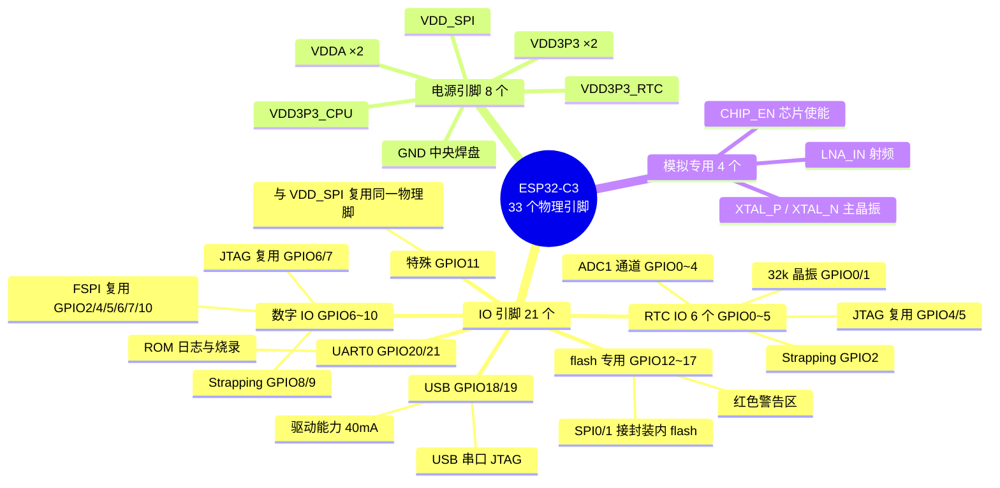
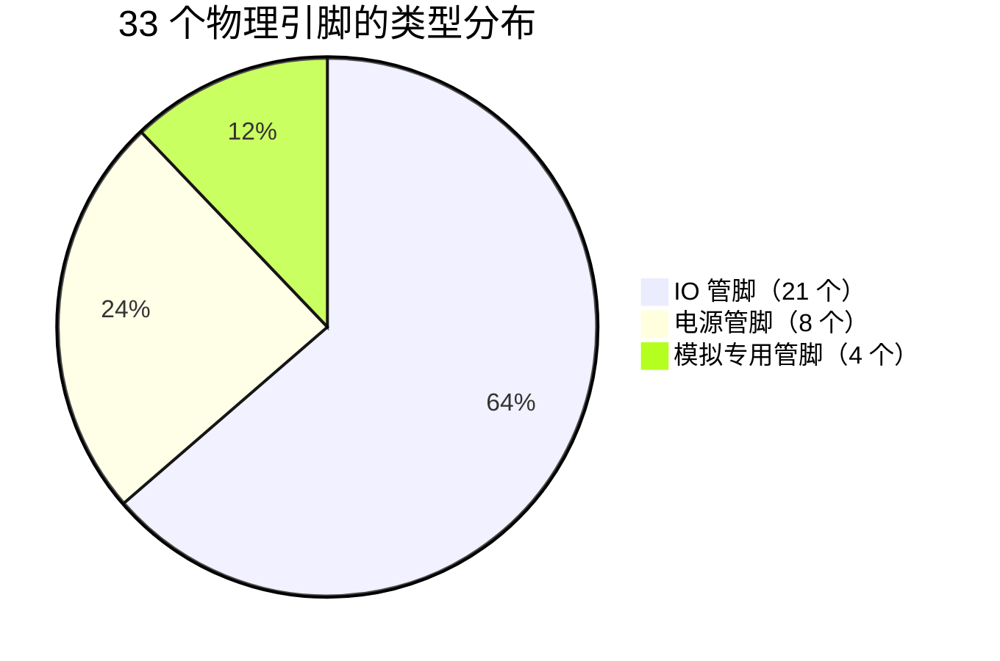
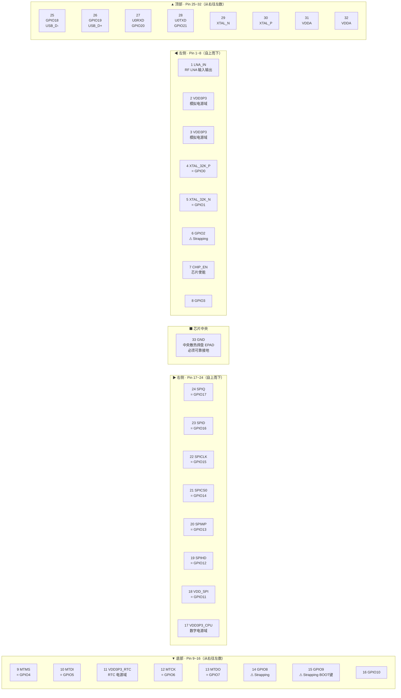
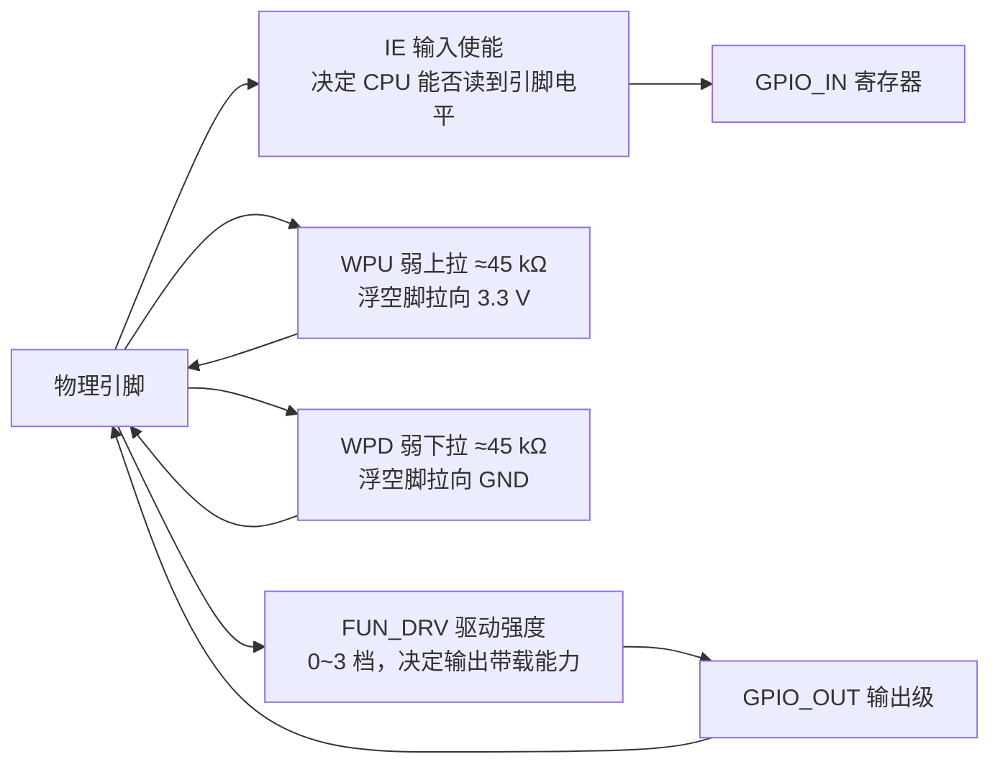
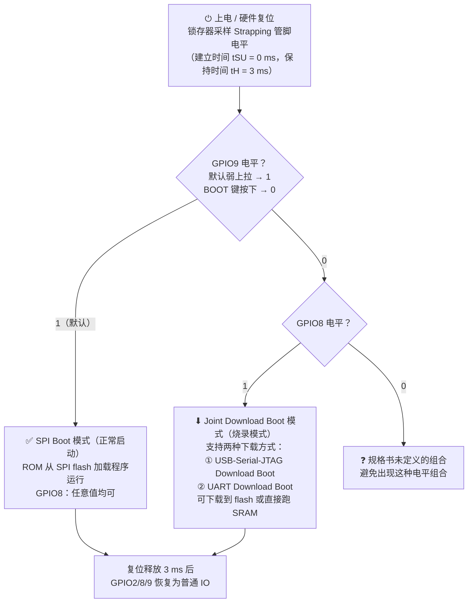
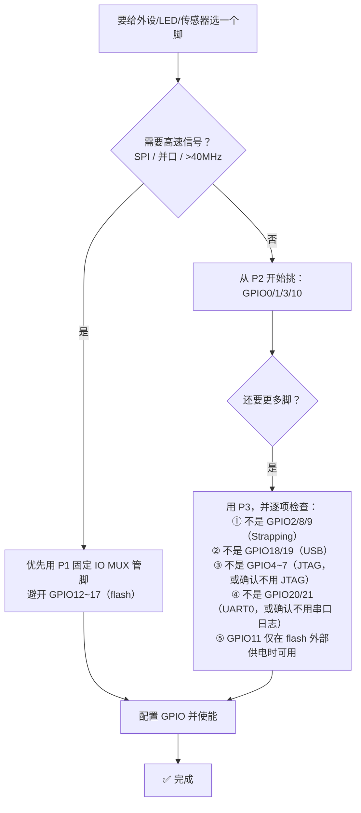
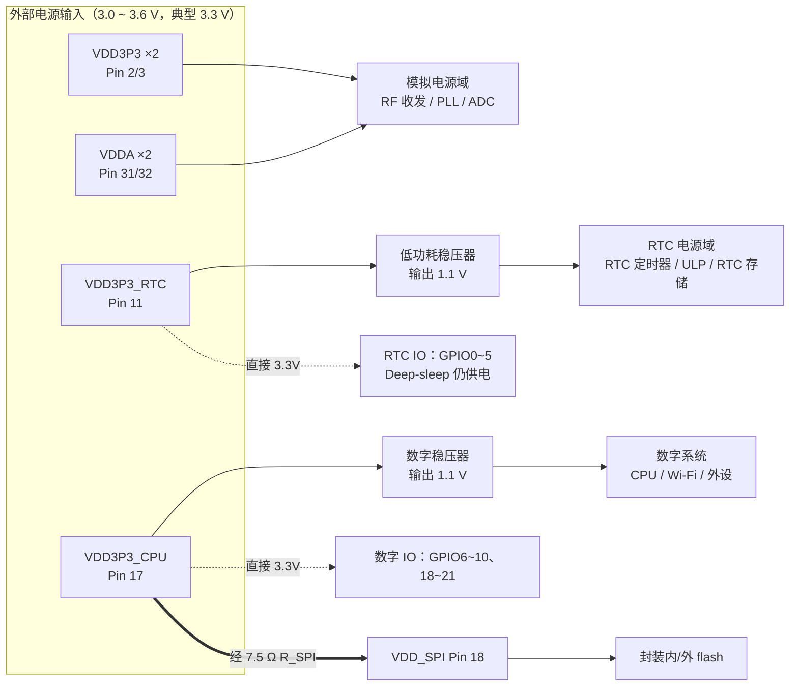
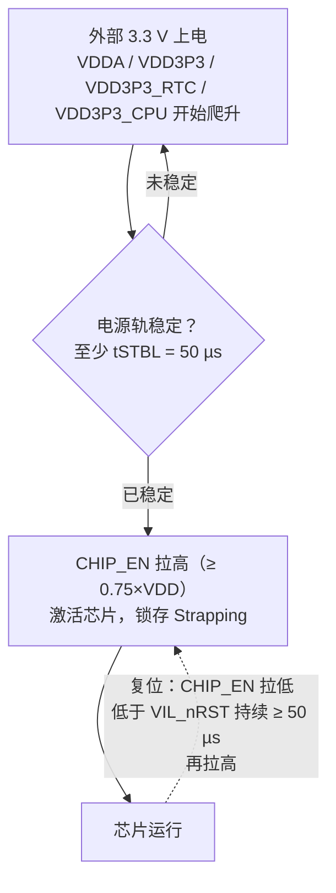
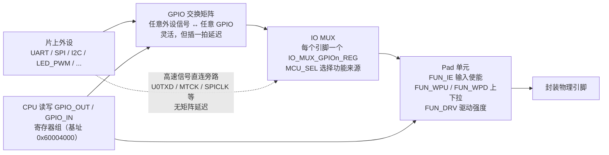
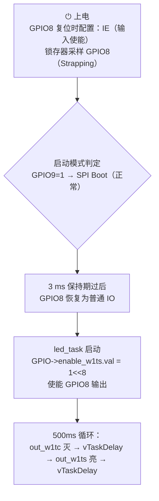

# ESP32-C3 引脚配置与使能 · 超级详细指南

> **数据来源**：乐鑫官方《ESP32-C3 系列芯片技术规格书》v2.5（中文版）第 2 章「管脚」、第 3 章「启动配置项」、第 5 章「电气特性」。
>
> **适用芯片**：ESP32-C3 / ESP32-C3FH4 / ESP32-C3FN4 / ESP32-C3FH8X（22 个 GPIO）；
> ESP32-C3FH4X / ESP32-C3FH4AZ（16 个 GPIO，Pin 19~24 为空脚 NC）。
>
> **本仓库上下文**：`esp32c3-blink` 是裸机 FreeRTOS 工程，LED 接在 **GPIO8**（见 `main/main.c` 中 `LED_PIN 8U`），本文所有「如何使能」示例都会与本项目代码对齐。

---

## 目录

- [1. 芯片与引脚总览](#1-芯片与引脚总览)
- [2. 物理管脚布局图（QFN32 俯视图）](#2-物理管脚布局图qfn32-俯视图)
- [3. 全部 33 个物理引脚逐脚详解](#3-全部-33-个物理引脚逐脚详解)
- [4. 22 个 GPIO 逐一详解（复位状态 / 上下拉 / 复用 / 驱动能力）](#4-22-个-gpio-逐一详解)
- [5. Strapping 管脚与启动模式控制（GPIO2 / GPIO8 / GPIO9）](#5-strapping-管脚与启动模式控制)
- [6. GPIO 使用限制与外设管脚分配优先级](#6-gpio-使用限制与外设管脚分配优先级)
- [7. 模拟功能：ADC / XTAL_32K / USB](#7-模拟功能adc--xtal_32k--usb)
- [8. 通信接口引脚分配（UART / USB / JTAG / SPI）](#8-通信接口引脚分配)
- [9. 电源系统：电源域、稳压器、上电复位时序](#9-电源系统)
- [10. 上电毛刺警示表（硬件设计必看）](#10-上电毛刺警示表)
- [11. 如何使能一个 GPIO：寄存器级 / ESP-IDF / Arduino 三种姿势](#11-如何使能一个-gpio)
- [12. Blink 实战：本仓库 main.c 的 LED 引脚分析](#12-blink-实战本仓库-mainc-的-led-引脚分析)
- [13. 常见坑 FAQ](#13-常见坑-faq)

---

## 1. 芯片与引脚总览

| 项目 | 参数 |
| --- | --- |
| 封装 | QFN32（5 × 5 mm），共 **33 个物理引脚**（含中央散热焊盘 EPAD = Pin 33 GND） |
| CPU | RISC-V 32 位单核，最高 160 MHz |
| 无线 | 2.4 GHz Wi-Fi 802.11b/g/n + Bluetooth 5 (LE) |
| GPIO 总数 | **22 个**（GPIO0 ~ GPIO21）；FH4X / FH4AZ 型号为 16 个 |
| Strapping 管脚 | **GPIO2、GPIO8、GPIO9**（共 3 个，上电时决定启动配置） |
| 封装内 flash 专用管脚 | **GPIO12 ~ GPIO17**（共 6 个：SPIHD/SPIWP/SPICS0/SPICLK/SPID/SPIQ） |
| USB 串口/JTAG | **GPIO18 (D-)、GPIO19 (D+)** |
| JTAG（调试） | **GPIO4 (MTMS)、GPIO5 (MTDI)、GPIO6 (MTCK)、GPIO7 (MTDO)** |
| UART0（日志/烧录） | **GPIO20 (U0RXD)、GPIO21 (U0TXD)** |
| RTC IO（Deep-sleep 可用） | **GPIO0 ~ GPIO5**（由 VDD3P3_RTC 供电） |
| ADC | ADC1：GPIO0~GPIO4（5 通道，出厂校准）；ADC2：GPIO5（1 通道，**未校准且部分芯片版本失效**） |

### 1.1 引脚分类一图流



### 1.2 引脚类型占比



> 📌 注意一个细节：GPIO 名义上有 **22 个**，但物理 IO 引脚只有 21 个——因为 **GPIO11 和电源脚 VDD_SPI 复用同一个物理引脚（Pin 18）**，默认该脚当电源用，只有当 flash 采用外部供电时它才能当 GPIO。

---

## 2. 物理管脚布局图（QFN32 俯视图）

下图对应规格书**图 2-1**（ESP32-C3 / C3FH4 / C3FN4 / C3FH8X 俯视图）。引脚序号从 Pin 1（LNA_IN，左上角有 Pin 1 定位圆点）开始**逆时针**编号。



> ⚠️ C3FH4X / C3FH4AZ 型号：Pin 19 ~ 24（SPIHD/SPIWP/SPICS0/SPICLK/SPID/SPIQ）**未引出，为空脚 NC**，所以这两种型号只有 16 个 GPIO。

---

## 3. 全部 33 个物理引脚逐脚详解

下表整合规格书 **表 2-1（管脚概述）** 与各章描述。缩写含义：

| 缩写 | 含义 |
| --- | --- |
| `IE` | 输入使能（Input Enable）：复位时/复位后该脚默认允许读入电平 |
| `WPU` | 内部弱上拉电阻使能（约 45 kΩ） |
| `WPD` | 内部弱下拉电阻使能（约 45 kΩ） |
| `USB_PU` | USB 上拉电阻使能（由 USB 控制器管理，不是普通 GPIO 上拉） |
| I/O/T | 输入 / 输出 / 高阻（三态） |

| 序号 | 名称 | 类型 | 供电域 | 复位时 | 复位后 | IO MUX 功能 | 模拟功能 | 详细作用 |
| :-: | --- | :-: | :-: | :-: | :-: | --- | :-: | --- |
| 1 | **LNA_IN** | 模拟 | — | — | — | — | — | 射频低噪声放大器（RF LNA）输入/输出。Wi-Fi/蓝牙天线前端，**严禁当 GPIO**。外接天线匹配网络或直接接 PCB 天线 |
| 2 | **VDD3P3** | 电源 | — | — | — | — | — | 3.3 V 输入，模拟电源域（RF 收发器、PLL、ADC 模拟部分）。**必须**就近加去耦电容 |
| 3 | **VDD3P3** | 电源 | — | — | — | — | — | 同上，第二个模拟电源引脚 |
| 4 | **XTAL_32K_P** | IO | VDD3P3_RTC | — | — | GPIO0（F0/F1） | XTAL_32K_P / ADC1_CH0 | 复用 **GPIO0**。默认功能：外部 32 kHz 晶振正端输入/输出（RTC 慢时钟）。也可作 ADC1 通道 0 或普通 GPIO。属于 RTC IO，Deep-sleep 期间仍供电 |
| 5 | **XTAL_32K_N** | IO | VDD3P3_RTC | — | — | GPIO1（F0/F1） | XTAL_32K_N / ADC1_CH1 | 复用 **GPIO1**，32 kHz 晶振负端。其余同 GPIO0。RTC IO |
| 6 | **GPIO2** | IO | VDD3P3_RTC | IE | IE | GPIO2、GPIO2、FSPIQ(I1/O/T) | ADC1_CH2 | 普通双向 IO + ADC1 通道 2 + SPI2 的 FSPIQ。⚠ **Strapping 管脚**：官方建议上拉（毛刺考虑），实际不控制启动模式 |
| 7 | **CHIP_EN** | 模拟 | — | — | — | — | — | **芯片使能脚**：高电平 = 上电工作，低电平 = 掉电关闭。**绝不能浮空**（典型 RC 缓启动电路：RC ≥ 1 ms 拉高）。也是整机复位脚（拉低 ≥ 50 µs 再拉高可复位芯片） |
| 8 | **GPIO3** | IO | VDD3P3_RTC | IE | IE | GPIO3、GPIO3 | ADC1_CH3 | 普通双向 IO + ADC1 通道 3。复位后默认输入使能。RTC IO。无特殊限制，**做 LED/按键的最佳选择之一** |
| 9 | **MTMS** | IO | VDD3P3_RTC | IE | — | GPIO4、MTMS(I1)、FSPIHD(I1/O/T) | ADC1_CH4 | 复用 **GPIO4**。默认复用为 JTAG 测试模式选择（Test Mode Select）。作为 GPIO 用时无输入使能默认，需软件开 IE。⚠ JTAG 复用，调试期慎用 |
| 10 | **MTDI** | IO | VDD3P3_RTC | IE | — | GPIO5、MTDI(I1)、FSPIWP(I1/O/T) | ADC2_CH0 | 复用 **GPIO5**。JTAG 数据输入。⚠ 也是 ADC2 的唯一通道（且部分芯片版本 ADC2 失效），⚠ JTAG 复用 |
| 11 | **VDD3P3_RTC** | 电源 | — | — | — | — | — | 3.3 V 输入，RTC 及部分数字电源域。**给 GPIO0~5（RTC IO）供电**，Deep-sleep 时保持供电，所以 RTC GPIO 的电平在深睡期间能维持 |
| 12 | **MTCK** | IO | VDD3P3_CPU | IE¹ | — | GPIO6、MTCK(I1)、FSPICLK(I1/O/T) | — | 复用 **GPIO6**。JTAG 测试时钟（Test Clock）。¹当 eFuse `EFUSE_DIS_PAD_JTAG=0`（默认）时复位后 IE 且内部弱上拉。⚠ 上电有 5 ns 低电平毛刺 |
| 13 | **MTDO** | IO | VDD3P3_CPU | IE | — | GPIO7、MTDO(O/T)、FSPID(I1/O/T) | — | 复用 **GPIO7**。JTAG 数据输出。⚠ 上电有 5 ns 低电平毛刺 |
| 14 | **GPIO8** | IO | VDD3P3_CPU | IE | IE | GPIO8（F0/F1） | — | 普通双向 IO，复位前后都输入使能。⚠ **Strapping 管脚**：参与启动模式与 UART ROM 日志控制（见第 5 章）。**本仓库 LED 即此脚** |
| 15 | **GPIO9** | IO | VDD3P3_CPU | IE, WPU | IE, WPU | GPIO9（F0/F1） | — | ⚠ **最重要的 Strapping 管脚（BOOT 键）**：复位时为 1 → SPI Boot；为 0 → 进入下载模式（需 GPIO8=1）。默认弱上拉。开发板上的 BOOT 按键就是把它按到 GND |
| 16 | **GPIO10** | IO | VDD3P3_CPU | IE | IE | GPIO10、GPIO10、FSPICS0(I1/O/T) | — | 普通双向 IO + SPI2 片选 FSPICS0。⚠ 上电有 5 ns 低电平毛刺——接了对外设的要留意 |
| 17 | **VDD3P3_CPU** | 电源 | — | — | — | — | — | 3.3 V 输入，数字电源域。**给 GPIO6~10、GPIO18~21（数字 IO）供电**。写 eFuse 时电压不得超过 3.3 V |
| 18 | **VDD_SPI** | 电源 | VDD3P3_CPU | — | — | GPIO11 | — | 默认为 **flash 供电脚（输出）**：内部经 7.5 Ω 的 R_SPI 由 VDD3P3_CPU 轨供电给封装内/外 flash。⚠ 与 **GPIO11** 复用：仅当 flash 采用外部独立电源时，本脚才能当 GPIO11 用 |
| 19 | **SPIHD** | IO | VDD_SPI / VDD3P3_CPU | WPU | IE, WPU | GPIO12、SPIHD(I1/O/T) | — | 复用 **GPIO12**。flash 的 HOLD# 信号（挂起）。🔴 已连接封装内 flash，**勿作他用** |
| 20 | **SPIWP** | IO | VDD_SPI / VDD3P3_CPU | WPU | IE, WPU | GPIO13、SPIWP(I1/O/T) | — | 复用 **GPIO13**。flash 的 WP# 写保护信号。🔴 同上，flash 专用 |
| 21 | **SPICS0** | IO | VDD_SPI / VDD3P3_CPU | WPU | IE, WPU | GPIO14、SPICS0(O/T) | — | 复用 **GPIO14**。flash 片选 CS0。🔴 flash 专用 |
| 22 | **SPICLK** | IO | VDD_SPI / VDD3P3_CPU | WPU | IE, WPU | GPIO15、SPICLK(O/T) | — | 复用 **GPIO15**。flash 时钟。🔴 flash 专用 |
| 23 | **SPID** | IO | VDD_SPI / VDD3P3_CPU | WPU | IE, WPU | GPIO16、SPID(I1/O/T) | — | 复用 **GPIO16**。flash 主出从入（DI）。🔴 flash 专用 |
| 24 | **SPIQ** | IO | VDD_SPI / VDD3P3_CPU | WPU | IE, WPU | GPIO17、SPIQ(I1/O/T) | — | 复用 **GPIO17**。flash 主入从出（DO）。🔴 flash 专用 |
| 25 | **GPIO18** | IO | VDD3P3_CPU | USB_PU | USB_PU | GPIO18（F0/F1） | USB_D- | ⚠ 默认接 USB 串口/JTAG 控制器的 **USB D-**。驱动能力高达 40 mA。要当普通 GPIO 需重新配置。⚠ 上电有 **50 µs 高电平毛刺**（注意！） |
| 26 | **GPIO19** | IO | VDD3P3_CPU | USB_PU | USB_PU | GPIO19（F0/F1） | USB_D+ | ⚠ 默认接 USB 串口/JTAG 控制器的 **USB D+**。其余同 GPIO18 |
| 27 | **U0RXD** | IO | VDD3P3_CPU | — | IE, WPU | GPIO20、U0RXD(I1) | — | 复用 **GPIO20**。UART0 接收（ROM 日志输出方向之一）。复位后默认输入使能 + 弱上拉。⚠ 上电有 5 ns 低电平毛刺 |
| 28 | **U0TXD** | IO | VDD3P3_CPU | — | WPU² | GPIO21、U0TXD(O) | — | 复用 **GPIO21**。UART0 发送——**上电初期 ROM 日志从这里打印**。²WPU 同时意味着输出使能（启动即输出日志）。UART0 通常要保留作日志/烧录 |
| 29 | **XTAL_N** | 模拟 | — | — | — | — | — | 40 MHz 主晶振负端（差分 P/N）。外接晶振 + 负载电容。⚠ ESP32-C3 **必须有外部主晶振才能运行** |
| 30 | **XTAL_P** | 模拟 | — | — | — | — | — | 40 MHz 主晶振正端。同上 |
| 31 | **VDDA** | 电源 | — | — | — | — | — | 3.3 V 输入，模拟电源域 |
| 32 | **VDDA** | 电源 | — | — | — | — | — | 3.3 V 输入，模拟电源域 |
| 33 | **GND** | 电源 | — | — | — | — | — | 中央散热焊盘（EPAD）。**必须接地**：既是地，也是把芯片运行热量导出的散热通道。PCB 上建议打一排过孔到地平面 |

---

## 4. 22 个 GPIO 逐一详解

### 4.1 GPIO0 ~ GPIO21 总表

「复位时 / 复位后」列来自规格书表 2-1 的预设配置——**这是芯片上电瞬间、你的程序还没跑之前，每个脚的硬件默认状态**。

| GPIO | 物理脚 | 供电域 | 复位时 | 复位后 | 复用功能（IO MUX F0 / F1 / F2） | 模拟功能 | 驱动电流 | 使用注意 |
| :-: | :-: | :-: | :-: | :-: | --- | :-: | :-: | --- |
| **GPIO0** | 4 | VDD3P3_RTC（RTC） | — | — | GPIO0 / GPIO0 / — | XTAL_32K_P、ADC1_CH0 | 20 mA | 可选外接 32k 晶振正端；ADC1_CH0；Deep-sleep 下仍可配置 |
| **GPIO1** | 5 | VDD3P3_RTC（RTC） | — | — | GPIO1 / GPIO1 / — | XTAL_32K_N、ADC1_CH1 | 20 mA | 32k 晶振负端；ADC1_CH1；RTC IO |
| **GPIO2** | 6 | VDD3P3_RTC（RTC） | IE | IE | GPIO2 / GPIO2 / FSPIQ | ADC1_CH2 | **10 mA** | ⚠ Strapping（建议上拉）；驱动能力较小，带大负载注意 |
| **GPIO3** | 8 | VDD3P3_RTC（RTC） | IE | IE | GPIO3 / GPIO3 / — | ADC1_CH3 | **10 mA** | 干净的通用 IO，推荐做 LED / 按键 / 传感器 |
| **GPIO4** | 9 | VDD3P3_RTC（RTC） | IE | — | GPIO4 / MTMS / FSPIHD | ADC1_CH4 | **10 mA** | ⚠ 默认 JTAG（MTMS）；复位后无输入使能，作输入需开 IE |
| **GPIO5** | 10 | VDD3P3_RTC（RTC） | IE | — | GPIO5 / MTDI / FSPIWP | ADC2_CH0 | **10 mA** | ⚠ JTAG（MTDI）+ ADC2 唯一通道（部分版本失效） |
| **GPIO6** | 12 | VDD3P3_CPU（数字） | — | IE | GPIO6 / MTCK / FSPICLK | — | 20 mA | ⚠ JTAG（MTCK）；复位时无 IE、复位后 IE |
| **GPIO7** | 13 | VDD3P3_CPU（数字） | — | IE | GPIO7 / MTDO / FSPID | — | 20 mA | ⚠ JTAG（MTDO） |
| **GPIO8** | 14 | VDD3P3_CPU（数字） | IE | IE | GPIO8 / GPIO8 / — | — | 20 mA | ⚠ Strapping；**本仓库 LED 脚**；默认输入使能 |
| **GPIO9** | 15 | VDD3P3_CPU（数字） | IE, WPU | IE, WPU | GPIO9 / GPIO9 / — | — | 20 mA | ⚠ Strapping（BOOT）；默认上拉，接按键到 GND |
| **GPIO10** | 16 | VDD3P3_CPU（数字） | IE | IE | GPIO10 / GPIO10 / FSPICS0 | — | 20 mA | ⚠ 上电 5 ns 低毛刺；FSPI 片选复用 |
| **GPIO11** | 18 | VDD_SPI（默认电源） | — | — | GPIO11 / GPIO11 / — | — | 20 mA | ⚠ 与 VDD_SPI 复用，默认当电源脚；仅 flash 外部供电时可作 GPIO |
| **GPIO12** | 19 | VDD_SPI | WPU | IE, WPU | GPIO12 / SPIHD / — | — | 20 mA | 🔴 flash HOLD#，禁作他用 |
| **GPIO13** | 20 | VDD_SPI | WPU | IE, WPU | GPIO13 / SPIWP / — | — | 20 mA | 🔴 flash WP# |
| **GPIO14** | 21 | VDD_SPI | WPU | IE, WPU | GPIO14 / SPICS0 / — | — | 20 mA | 🔴 flash CS0 |
| **GPIO15** | 22 | VDD_SPI | WPU | IE, WPU | GPIO15 / SPICLK / — | — | 20 mA | 🔴 flash CLK |
| **GPIO16** | 23 | VDD_SPI | WPU | IE, WPU | GPIO16 / SPID / — | — | 20 mA | 🔴 flash DI |
| **GPIO17** | 24 | VDD_SPI | WPU | IE, WPU | GPIO17 / SPIQ / — | — | 20 mA | 🔴 flash DO |
| **GPIO18** | 25 | VDD3P3_CPU（数字） | USB_PU | USB_PU | GPIO18 / GPIO18 / — | USB_D- | **40 mA** | ⚠ USB D-；上电 **50 µs 高电平毛刺**；作 GPIO 默认禁用内部上下拉（需软件开 IO_MUX_FUN_WPU/WPD） |
| **GPIO19** | 26 | VDD3P3_CPU（数字） | USB_PU | USB_PU | GPIO19 / GPIO19 / — | USB_D+ | **40 mA** | ⚠ USB D+；其余同 GPIO18 |
| **GPIO20** | 27 | VDD3P3_CPU（数字） | — | IE, WPU | GPIO20 / U0RXD / — | — | 20 mA | ⚠ UART0 RX；上电 5 ns 低毛刺；默认上拉方便外接 |
| **GPIO21** | 28 | VDD3P3_CPU（数字） | — | WPU（含输出使能） | GPIO21 / U0TXD / — | — | 20 mA | ⚠ UART0 TX；启动即向主机打印 ROM 日志，**一般要保留** |

### 4.2 驱动电流速查

| 管脚 | 默认驱动能力 |
| --- | :-: |
| GPIO2、GPIO3、MTMS(GPIO4)、MTDI(GPIO5) | **10 mA** |
| GPIO18、GPIO19（USB 管脚） | **40 mA** |
| 其余所有管脚 | 20 mA |

> 驱动强度可通过 IO MUX 寄存器的 `FUN_DRV` 字段在软件里调（0~3 四档，档位 3 时高电平拉电流约 40 mA / 低电平灌电流约 28 mA，见第 9.5 节电气特性）。**10 mA 的脚（GPIO2/3/4/5）带 LED 时建议加三极管或降低 LED 电流。**

### 4.3 输入使能 / 上拉 / 下拉机制

每个 GPIO 的 Pad 内部有三组独立开关，全部可软件控制：



- **IE（输入使能）**：复位后只有部分脚默认打开（见表 4.1）。想读一个脚，先确保 IE 打开（IDF 的 `gpio_set_direction(INPUT)` 会自动处理）。
- **WPU / WPD**：弱上拉 / 下拉约 45 kΩ，用于按键、I2C 总线、Strapping 电平保持。⚠ 注意 GPIO18/19 在 USB 功能下由 USB 上拉控制，当普通 GPIO 时默认上下拉**都被禁用**。
- **一个脚不能同时开 WPU 和 WPD**（会互相抵消，产生 ~1.65 V 分压）。

---

## 5. Strapping 管脚与启动模式控制

ESP32-C3 有 **3 个 Strapping 管脚**：GPIO2、GPIO8、GPIO9。芯片在上电/硬件复位瞬间，由硬件锁存器采样它们的电平，**在 CPU 执行任何代码之前**就决定了启动行为。复位释放约 **3 ms**（保持时间 tH）之后，这些脚就恢复为普通 IO，可随便用。

### 5.1 默认配置（管脚浮空时）

| Strapping 管脚 | 默认配置 | 复位采样值 | 硬件含义 |
| :-: | :-: | :-: | --- |
| GPIO2 | 浮空（无上下拉） | 不定 | 实际不控制启动模式，但因上电毛刺**官方建议外部上拉** |
| GPIO8 | 浮空（无上下拉） | 不定 | 控制 Joint Download Boot 与 UART ROM 日志 |
| GPIO9 | **弱上拉** | **1** | ⭐ BOOT 键管脚：决定 SPI Boot 还是下载模式 |

### 5.2 启动模式决策流程



> 📌 **GPIO2 的特殊说明**（规格书原注）：GPIO2 实际上不控制 SPI Boot 和 Joint Download Boot 模式，但由于它在上电过程中可能出现电平毛刺，**官方建议把 GPIO2 上拉**，避免干扰。

### 5.3 如何在硬件上改变 Strapping 值

| 方法 | 说明 |
| --- | --- |
| 外部上拉/下拉电阻 | 推荐接 10 kΩ 到 3.3 V / GND。BOOT 键 = GPIO9 对 GND 的按键（按下即 0） |
| 主机 MCU 控制 | 如果 ESP32-C3 作为某个主机 MCU 的从设备，可由主机在上电前控制这些脚电平 |
| eFuse 烧写 | eFuse 参数一次性烧写后，GPIO8 对 UART ROM 日志的控制作用被 eFuse 覆盖（见 5.4） |

### 5.4 UART0 ROM 日志打印控制（GPIO8 + eFuse）

| UART0 ROM 日志 | EFUSE_UART_PRINT_CONTROL | GPIO8 |
| :-: | :-: | :-: |
| **使能（默认）** | **0** | 忽略（GPIO8 无关） |
| 使能 | 1 | 0 |
| 使能 | 2 | 1 |
| 关闭 | 1 | 1 |
| 关闭 | 2 | 0 |
| 关闭 | 3 | 忽略 |

USB 串口/JTAG 的 ROM 日志由 eFuse 参数 `EFUSE_USB_PRINT_CHANNEL` / `EFUSE_DIS_USB_SERIAL_JTAG` 控制。默认（未烧写）情况下 **UART0 和 USB 串口/JTAG 同时打印 ROM 日志**。

### 5.5 锁存器机制（为什么 Strapping 管脚复位后能随便用）

所有 Strapping 管脚都有**锁存器**：


所以：**上电时**它们是配置输入；**运行中**它们是普通 GPIO，怎么用都行——这正是本仓库把 GPIO8 用作 LED 的前提。

---

## 6. GPIO 使用限制与外设管脚分配优先级

### 6.1 两类「危险」管脚

规格书用**红色**和**黄色**高亮标记需要谨慎的管脚：

| 标记 | 管脚 | 原因 |
| :-: | --- | --- |
| 🔴 红 | GPIO12~GPIO17（SPIHD/SPIWP/SPICS0/SPICLK/SPID/SPIQ） | 已连接**封装内 flash** 的 SPI0/1 总线，**绝对不要挪作他用**，动了芯片直接起不来 |
| 🟡 黄 | GPIO2、GPIO8、GPIO9 | Strapping 管脚，上电电平要保证 |
| 🟡 黄 | GPIO18、GPIO19 | 默认 USB 串口/JTAG（烧录/调试都靠它），当 GPIO 前要重新配置 |
| 🟡 黄 | GPIO4、GPIO5、GPIO6、GPIO7 | JTAG 调试口，调试期慎用 |
| 🟡 黄 | GPIO20、GPIO21 | UART0（日志/烧录口），一般保留 |
| 🟡 黄 | GPIO11（Pin 18 VDD_SPI） | 默认是 flash 供电电源脚，仅 flash 用外部电源时可作 GPIO |

### 6.2 外设管脚分配优先级（规格书表 2-7）

给任何外设分配引脚时，按优先级从高到低选：

| 优先级 | 含义 | 包含的管脚 |
| :-: | --- | --- |
| **P1** 固定管脚 | 通过 IO MUX 直连外设信号，速度最快、无矩阵延迟 | USB：GPIO18/19；JTAG：GPIO4~7；ADC1：GPIO0~4；ADC2：GPIO5；UART0：GPIO20/21；SPI0/1（flash）：GPIO12~17；SPI2(FSPI) 固定脚：GPIO2(FSPIQ)、GPIO4~7(FSPIHD/WP/CLK/D)、GPIO10(FSPICS0) |
| **P2** 自由分配 | 没有任何限制的通用 GPIO | GPIO0、GPIO1、GPIO3、GPIO10、GPIO11、GPIO18、GPIO19 |
| **P3** 注意冲突 | 使用前检查是否撞上 Strapping / USB / JTAG / UART0 / VDD_SPI | GPIO2、GPIO8、GPIO9（Strapping）；GPIO4~7（JTAG）；GPIO18/19（USB）；GPIO20/21（UART0）；GPIO11（VDD_SPI） |
| **P4** 不推荐 | 已被占用或不建议使用 | GPIO12~GPIO17（flash 总线） |

> 📌 与 C3 不同：**UART1、I2C、I2S、TWAI、LED PWM、RMT 没有固定管脚**，它们的信号可以经由 GPIO 交换矩阵映射到**任意** GPIO 上（连 P4 的 flash 脚理论上也能映射，但会挂掉 flash，别这么做）。UART0 和 SPI 有固定管脚，也可以重新映射，但一般不挪。

### 6.3 选脚决策流程



---

## 7. 模拟功能：ADC / XTAL_32K / USB

### 7.1 ADC 通道映射

| ADC 通道 | GPIO | 物理脚 | 校准状态 |
| :-: | :-: | :-: | --- |
| ADC1_CH0 | GPIO0 | 4 | ✅ 出厂校准 |
| ADC1_CH1 | GPIO1 | 5 | ✅ 出厂校准 |
| ADC1_CH2 | GPIO2 | 6 | ✅ 出厂校准（⚠ Strapping） |
| ADC1_CH3 | GPIO3 | 8 | ✅ 出厂校准 |
| ADC1_CH4 | GPIO4 | 9 | ✅ 出厂校准（⚠ JTAG） |
| ADC2_CH0 | GPIO5 | 10 | ❌ 未出厂校准；**部分芯片版本 ADC2 无法工作**（见勘误表） |

- 12 位 SAR ADC，最高采样率 **100 kSPS**；外接 100 nF 电容到测量脚可改善噪声。
- 4 档衰减（ATTEN）对应的有效量程（校准后总误差见规格书表 5-6）：

| 衰减档 | 有效测量范围 | 总误差 |
| :-: | :-: | :-: |
| ATTEN0 | 0 ~ 750 mV | ±10 mV |
| ATTEN1 | 0 ~ 1050 mV | ±10 mV |
| ATTEN2 | 0 ~ 1300 mV | ±10 mV |
| ATTEN3 | 0 ~ 2500 mV | ±35 mV |

> 📌 想测 3.3 V 电源电压？最大只能量到约 2.5 V（ATTEN3），需要外部分压电阻。

### 7.2 XTAL_32K（外部 32 kHz 时钟）

| 管脚 | GPIO | 功能 |
| :-: | :-: | --- |
| XTAL_32K_P（Pin 4） | GPIO0 | 32 kHz 时钟正端输入/输出 |
| XTAL_32K_N（Pin 5） | GPIO1 | 32 kHz 时钟负端 |

可选外接 32.768 kHz 无源晶振（或注入有源 32k 时钟）作为 RTC 慢时钟源；不用晶振时这两脚就是普通 GPIO0/GPIO1，还能当 ADC1 通道 0/1 用。

### 7.3 USB_D±（GPIO18 / GPIO19）

- 内部集成了全速 USB PHY，GPIO18 = D-、GPIO19 = D+，直连 **USB 串口/JTAG 控制器**（烧录 + 串口日志 + JTAG 三合一）。
- 默认 `USB_PU`：USB 上拉由 `USB_SERIAL_JTAG_DP/DM_PULLUP` 控制，阻值可经 `USB_SERIAL_JTAG_PULLUP_VALUE` 调整。
- **要用 GPIO18/19 当普通 IO**：需在软件里关闭 USB 功能 / 重新配置 IO MUX，且此时内部弱上下拉默认是**关闭**的，要用内部上拉得手动开 `IO_MUX_FUN_WPU`。
- USB 占用后，烧录方式退化为 UART0（GPIO20/21）。

### 7.4 内置温度传感器（无外部引脚）

测量范围 −40 ~ 125 °C，监测的是**芯片内部温度**（会高于环境温度，且随 CPU 频率和 IO 负载波动），只能看趋势，不适合做环境温度计。

---

## 8. 通信接口引脚分配

### 8.1 UART

| 接口 | 信号 | 固定管脚 | 说明 |
| :-: | --- | --- | --- |
| UART0 | U0TXD / U0RXD | GPIO21 / GPIO20 | ROM 日志 + esptool 烧录走这里，**强烈建议保留**。复位后 U0TXD 默认输出使能 + 弱上拉 |
| UART1 | 无固定脚 | 任意 GPIO（经 GPIO 矩阵） | 速率最高 5 Mbps，支持 RS232/RS485/IrDA、硬件流控 |

> 注意 ESP32-C3 只有 2 个 UART。

### 8.2 USB 串口/JTAG 控制器（GPIO18/19）

一个控制器三合一：CDC-ACM 虚拟串口 + JTAG 调试 + 下载通道。USB 2.0 全速（12 Mbit/s），即插即用，**这是 C3 上最方便的调试通道**。相关启动行为：

- `EFUSE_DIS_USB_SERIAL_JTAG` 可整体关闭它；
- SPI Boot 下它输出 ROM 日志；Joint Download Boot 下它是默认下载通道。

### 8.3 JTAG 调试口（GPIO4~7）

| 信号 | GPIO | 物理脚 | 方向 |
| :-: | :-: | :-: | :-: |
| MTMS（测试模式选择） | GPIO4 | 9 | 输入 |
| MTDI（测试数据输入） | GPIO5 | 10 | 输入 |
| MTCK（测试时钟） | GPIO6 | 12 | 输入 |
| MTDO（测试数据输出） | GPIO7 | 13 | 输出 |

- 复位后 `EFUSE_DIS_PAD_JTAG=0`（默认）时 MTCK 有 IE + 弱上拉。
- **想释放这 4 个脚当普通 GPIO**：用 USB 串口/JTAG 的 USB_D± 功能代替 JTAG 调试（eFuse `EFUSE_DIS_PAD_JTAG=1` 禁用 JTAG 管脚），或干脆不用 JTAG 直接复用。
- 外接 JTAG 适配器时注意 GPIO4/5/6/7 分属两个电源域（GPIO4/5 在 VDD3P3_RTC 域），IO 电平都兼容 3.3 V，没问题。

### 8.4 SPI 家族

| 接口 | 用途 | 管脚 | 能否挪用 |
| :-: | --- | --- | --- |
| SPI0/1 | **封装内/外 flash 专用** | GPIO12(HD)、GPIO13(WP)、GPIO14(CS0)、GPIO15(CLK)、GPIO16(D)、GPIO17(Q) | 🔴 禁止 |
| SPI2（FSPI/通用） | 用户外设（SD 卡、屏幕、传感器） | 固定脚：GPIO10(CS)、GPIO6(CLK)、GPIO7(D/MOSI)、GPIO2(Q/MISO)、GPIO4(HD)、GPIO5(WP)；也可映射到任意 GPIO | ✅ 推荐用固定脚 |
| SPI0/1 当 GPIO | — | GPIO12~17 | 仅当不用封装内 flash 时才有意义，C3 内置 flash 型号上等于不可用 |

SPI0/1 与 flash 的对应关系（规格书表 2-12，单/双/四线模式相同）：

| 芯片管脚 | GPIO | flash 信号 |
| :-: | :-: | :-: |
| SPICLK（22） | GPIO15 | CLK |
| SPICS0（21） | GPIO14 | CS |
| SPID（23） | GPIO16 | DI（MOSI） |
| SPIQ（24） | GPIO17 | DO（MISO） |
| SPIWP（20） | GPIO13 | WP |
| SPIHD（19） | GPIO12 | HOLD |

### 8.5 可任意映射的外设

I2C、I2S、TWAI（CAN）、LED PWM（6 通道）、RMT 红外（2 发 2 收）——全部经 GPIO 交换矩阵映射，**任意 GPIO 都能当**，写代码时 `i2c_param_config` / `ledc_set_pin` / `rmt_set_gpio` 指到哪个脚哪个脚就生效。选择时避开第 6.1 节的禁区即可。

---

## 9. 电源系统

### 9.1 电源管脚一览

| 物理脚 | 名称 | 方向 | 供电对象 | 说明 |
| :-: | :-: | :-: | --- | --- |
| 2, 3 | VDD3P3 | 输入 | 模拟电源域（RF、PLL） | 3.0 ~ 3.6 V，典型 3.3 V，每个脚 100 nF + 10 µF 去耦 |
| 11 | VDD3P3_RTC | 输入 | RTC 域 + **RTC IO（GPIO0~5）** | Deep-sleep 时保持供电 → RTC GPIO 电平在深睡中可维持 |
| 17 | VDD3P3_CPU | 输入 | 数字域 + **数字 IO（GPIO6~10, 18~21）** | 写 eFuse 时不得超过 3.3 V |
| 18 | VDD_SPI | 输入/输出 | 封装内/外 flash | 输入模式 = 外部给 flash 供电（此时可作 GPIO11）；输出模式 = 内部电源轨供电 |
| 31, 32 | VDDA | 输入 | 模拟电源域 | 与 VDD3P3 一样处理去耦 |
| 33 | GND | — | 全部 | EPAD 焊盘，打满过孔接地 |

### 9.2 电源域结构图



> 💡 关键理解：**GPIO 的电平域由它的供电脚决定**。GPIO0~5 由 VDD3P3_RTC 供电（RTC IO），其余数字 IO 由 VDD3P3_CPU 供电。两者在 Deep-sleep 中的行为完全不同——这就是「RTC GPIO」和「数字 GPIO」的本质区别。

### 9.3 上电与复位时序（CHIP_EN，Pin 7）



- `tSTBL ≥ 50 µs`：电源稳定后才能拉高 CHIP_EN（所以要用 RC 延时电路，不能 CHIP_EN 直接接电源）。
- `tRST ≥ 50 µs`：CHIP_EN 拉低至少 50 µs 才算有效复位。
- **CHIP_EN 绝对不能浮空**，否则芯片状态随机。

### 9.4 功耗模式与引脚的关系

| 模式 | 数字 IO（VDD3P3_CPU 域） | RTC IO（VDD3P3_RTC 域，GPIO0~5） |
| --- | --- | --- |
| Active / Modem-sleep | 正常工作 | 正常工作 |
| Light-sleep | 可设保持（hold）状态 | 可配置上拉/下拉保持 |
| Deep-sleep（5 µA 级） | **掉电，输出失效**（除非 GPIO hold 特殊保持） | 仍供电，RTC GPIO 可由 ULP/RTC 外设操作 |

### 9.5 直流电气特性（3.3 V, 25 °C，规格书表 5-4）

| 参数 | 值 |
| --- | :-: |
| 输入高电平 VIH | ≥ 0.75 × VDD（3.3 V 时约 2.475 V） |
| 输入低电平 VIL | ≤ 0.25 × VDD（约 0.825 V） |
| 输出高电平 VOH | ≥ 0.8 × VDD |
| 输出低电平 VOL | ≤ 0.1 × VDD |
| 高电平拉电流 IOH（PAD_DRIVER=3） | ~40 mA |
| 低电平灌电流 IOL（PAD_DRIVER=3） | ~28 mA |
| 内部弱上拉 / 弱下拉电阻 | 45 kΩ |
| 管脚电容 CIN | 2 pF |
| IO 输出总电流绝对最大值 | 1000 mA |
| 电源脚允许电压 | −0.3 ~ 3.6 V（绝对最大） |

---

## 10. 上电毛刺警示表

规格书 **表 2-2**：下列管脚在**上电过程中**会输出毛刺。如果这些脚接了敏感外设（电机驱动、复位脚、通信对端），硬件上要防护：

| 管脚 | 毛刺类型 | 典型持续时间 |
| :-: | :-: | :-: |
| MTCK（GPIO6） | 低电平毛刺 | 5 ns |
| MTDO（GPIO7） | 低电平毛刺 | 5 ns |
| GPIO10 | 低电平毛刺 | 5 ns |
| U0RXD（GPIO20） | 低电平毛刺 | 5 ns |
| **GPIO18（USB D-）** | **高电平毛刺** | **50 000 ns = 50 µs** ⚠ |

> ⚠ GPIO18 的 50 µs 高电平毛刺是最容易被忽略的坑：若 GPIO18 上接了 LED 或蜂鸣器，上电瞬间可能闪一下/响一声。GPIO18/19 默认还有 USB 上拉，上电期间会呈现高电平倾向——低电平有效的外设（点亮式 LED 接 GND 侧）要选别的脚。

---

## 11. 如何使能一个 GPIO

同一个目的有三种抽象层级，越往下越省事，越往上越接近硬件。**本仓库用的是第 11.1 节的裸机寄存器写法。**

### 11.0 先理解信号路径



- **普通 IO**（点灯、按键）：直接操作 GPIO_OUT / GPIO_IN 寄存器组。
- **外设信号**：在 IO MUX 里把该脚的 `MCU_SEL` 指向对应外设功能号（或经 GPIO 矩阵映射）。
- 具体寄存器位域定义见《ESP32-C3 技术参考手册》> IO MUX 和 GPIO 交换矩阵 章节。

### 11.1 寄存器级（裸机，本仓库 main.c 的写法）

```c
/* —— 以 LED_PIN = 8 为例，摘自本仓库 main/main.c —— */

GPIO->enable_w1ts.val = (1U << LED_PIN);   /* 输出使能：写 1 置位 GPIO8 的 OE */
GPIO->out_w1tc.val    = (1U << LED_PIN);   /* 输出低电平：Write-1-to-Clear */
GPIO->out_w1ts.val    = (1U << LED_PIN);   /* 输出高电平：Write-1-to-Set */
```

要点解释：

1. **基址**：GPIO 寄存器组在 `0x60004000`（`soc/gpio_struct.h` 里的 `gpio_dev_t` 已按官方布局映射好）。
2. **为什么用 W1TS/W1TC 而不是直接写 OUT 寄存器**：OUT 是读改写，中断里容易被别的代码覆盖；W1TS（write-1-to-set）/ W1TC（write-1-to-clear）是原子操作，写 1 的位被置/清，其他位不受影响。**多任务裸机项目务必用 W1TS/W1TC。**
3. **输入使能（IE）**：GPIO_ENABLE 寄存器清 0 即输入模式；再通过 IO MUX 的 `FUN_IE` 位开启输入缓冲，之后读 `GPIO->in` 即可。
4. **上下拉**：写 IO_MUX_GPIOn_REG 的 `FUN_WPU` / `FUN_WPD` 位（例如按键输入时开 WPU）。
5. **驱动强度**：IO_MUX_GPIOn_REG 的 `FUN_DRV` 字段（0~3）。

> ⚠ GPIO 编号 ≥ 32 的芯片（如 S3）要用 enable1_w1ts / out1_w1ts（第二组寄存器），C3 的 GPIO0~21 全在第一组。

### 11.2 ESP-IDF 级（driver/gpio.h）

```c
#include "driver/gpio.h"

gpio_config_t io_conf = {
    .pin_bit_mask  = (1ULL << GPIO_NUM_8),   /* 选中 GPIO8 */
    .mode          = GPIO_MODE_OUTPUT,        /* 输出模式（自动使能 OE） */
    .pull_up_en    = GPIO_PULLUP_DISABLE,
    .pull_down_en  = GPIO_PULLDOWN_DISABLE,
    .intr_type     = GPIO_INTR_DISABLE,
};
gpio_config(&io_conf);

gpio_set_level(GPIO_NUM_8, 1);             /* 拉高 */
gpio_set_level(GPIO_NUM_8, 0);             /* 拉低 */

/* —— 输入 + 内部上拉（按键） —— */
gpio_set_direction(GPIO_NUM_9, GPIO_MODE_INPUT);
gpio_pullup_en(GPIO_NUM_9);
gpio_pulldown_dis(GPIO_NUM_9);
int level = gpio_get_level(GPIO_NUM_9);

/* —— 下降沿中断 —— */
gpio_set_intr_type(GPIO_NUM_9, GPIO_INTR_NEGEDGE);
gpio_install_isr_service(0);
gpio_isr_handler_add(GPIO_NUM_9, my_isr, NULL);

/* —— Deep-sleep 期间保持电平 —— */
gpio_hold_en(GPIO_NUM_3);
gpio_deep_sleep_hold_en();
```

### 11.3 Arduino 级

```cpp
pinMode(8, OUTPUT);
digitalWrite(8, HIGH);          // 点亮

pinMode(9, INPUT_PULLUP);       // 按键，用内部上拉
int v = digitalRead(9);

attachInterrupt(9, callback, FALLING);
```

### 11.4 特殊管脚的「使能」清单

| 目标 | 怎么做 |
| --- | --- |
| 释放 GPIO18/19 作普通 IO | 关闭 USB 功能并重配 IO MUX（`IO_MUX_FUN_WPU/WPD` 控制上下拉）；代价：失去 USB 烧录/串口 |
| 释放 GPIO4~7（JTAG） | eFuse `EFUSE_DIS_PAD_JTAG=1` 或软件将 MCU_SEL 切到 GPIO 功能；代价：失去有线 JTAG（USB-Serial-JTAG 调试不受影响） |
| 释放 GPIO12~17 | 无解（封装内 flash 永远占用）——换 GPIO11/18/19/20/21 之外的脚（GPIO0~10） |
| 使用 GPIO11 | 仅当 flash 由外部电源供电（VDD_SPI 作输入）时；内置 flash 的型号等于没有 GPIO11 |
| Strapping 管脚防误触发 | GPIO2 外部 10 kΩ 上拉；GPIO9 上拉 + BOOT 键；GPIO8 按需上拉（见 5.2） |
| CHIP_EN | RC 缓启动电路（≥1 ms 爬升），禁止浮空 |

---

## 12. Blink 实战：本仓库 main.c 的 LED 引脚分析

### 12.1 GPIO8 当 LED 的完整链路



### 12.2 用 GPIO8 点灯有什么坑？

| 风险点 | 分析 | 结论 |
| --- | --- | --- |
| GPIO8 是 Strapping 管脚 | LED + 限流电阻接在 GPIO8 与 GND 之间，相当于一个**负载**，上电时可能把 GPIO8 电平拉低 | 进入 Joint Download Boot（BOOT 键按下时）**要求 GPIO8=1**，LED 负载可能干扰下载模式。影响只发生在烧录场景，正常启动（GPIO9=1 → SPI Boot）不受 GPIO8 影响 ✅ |
| 上电初期状态 | GPIO8 复位时是输入使能 + 浮空，LED 状态不定（弱上电趋势看外设） | 若要求上电灯不闪，LED 驱动电路选**高电平点亮**并接受短暂不定态，或换 GPIO3 |
| 驱动能力 | GPIO8 默认 20 mA | 直推 LED（限流电阻 ≥ 150 Ω）没问题 |

> ✅ 顺带一提：很多 C3 官方开发板把 WS2812 RGB 灯放在 GPIO8，正是因为 WS2812 数据脚输入是高阻态，不会干扰 Strapping 采样；普通 LED 直挂则要留意上表第一行。

### 12.3 如果想换一个「零风险」的 LED 引脚

按第 6.2 节优先级，最佳候选（P2 无限制脚）：

| 候选 | GPIO | 优点 | 代价 |
| --- | :-: | --- | --- |
| **首选** | GPIO3 | RTC 域、干净无复用、ADC1_CH3 兜底 | 驱动 10 mA，直推 LED 需限流 ≥ 330 Ω |
| 次选 | GPIO10 | 数字域 20 mA | 上电 5 ns 低毛刺；占掉 FSPICS0 复用 |
| 保留 | GPIO0 / GPIO1 | RTC 域 | 占掉 32k 晶振与 ADC1 通道 |

改动方法（裸机）：把 `main.c` 里 `#define LED_PIN 8U` 改成 `3U` 即可，寄存器操作代码完全不用动（GPIO0~21 同一组寄存器）。

---

## 13. 常见坑 FAQ

**Q1：为什么我的 GPIO 读进来永远是 0？**
复位后只有部分脚默认输入使能（表 4.1）。先确认 IE 打开：IDF 用 `gpio_set_direction(GPIO_MODE_INPUT)`；裸机确认 `GPIO_ENABLE` 对应位为 0 且 IO MUX `FUN_IE` 已置位。

**Q2：GPIO12~17 为什么配置了没反应/系统崩了？**
它们焊死在封装内 flash 的 SPI0/1 总线上，任何输出使能都会打断 flash 取指。用 GPIO0~10。

**Q3：上电 LED 闪了一下/蜂鸣器叫了一声？**
查第 10 章毛刺表——尤其 GPIO18 的 50 µs 高电平毛刺和 GPIO10/MTCK/MTDO/U0RXD 的 5 ns 毛刺。

**Q4：BOOT 键按下进不了下载模式？**
Joint Download Boot 需要 GPIO9=0 **且 GPIO8=1**。确认 GPIO8 没有被外设死拉到地（LED 负载也有嫌疑）；必要时给 GPIO8 加 10 kΩ 上拉。

**Q5：想用 ADC 测电池电压（3.x V）报量程错？**
ADC 最大有效量程 ATTEN3 ≈ 0~2500 mV，必须外部电阻分压；并且 ADC2（GPIO5）部分芯片版本失效，优先用 ADC1（GPIO0~4）。

**Q6：Deep-sleep 后 GPIO 电平全没了？**
数字 IO（GPIO6~10、18~21）在 Deep-sleep 掉电。想保持电平：进睡前 `gpio_hold_en()` + `gpio_deep_sleep_hold_en()`，或改用 RTC IO（GPIO0~5）。

**Q7：USB 插上电脑没识别？**
GPIO18/19 就是 USB，若软件已把它们配成普通 GPIO，USB 自然消失。烧录时可改用 UART0（GPIO20/21）+ USB-UART 桥，或擦除后再插。

**Q8：WPU 和 WPD 能同时开吗？**
不能。45 kΩ 对 45 kΩ 分压，输入会悬在约 1.65 V 中间电平，可能触发误中断。

**Q9：VDD_SPI 能当 GPIO11 用吗？**
默认不能——它在给 flash 供电。只有设计上让 flash 吃外部电源（VDD_SPI 变输入脚）时才行。绝大多数内置 flash 模块（C3FN4/C3FH4 等）上 GPIO11 是不可用的。

---

> 📚 延伸阅读：管脚多路复用寄存器的位级定义见《ESP32-C3 技术参考手册》>「IO MUX 和 GPIO 交换矩阵」；硬件布局规范见《ESP32-C3 硬件设计指南》；已知硬件缺陷见《ESP32-C3 系列芯片勘误表》。
